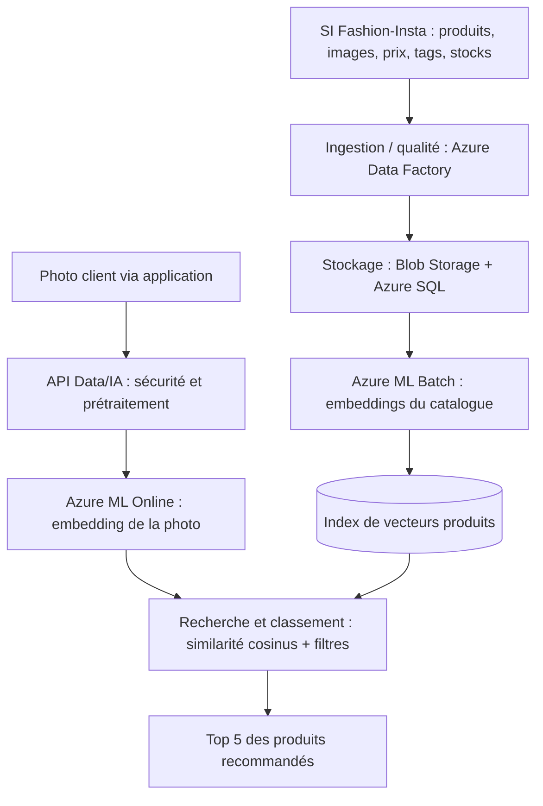
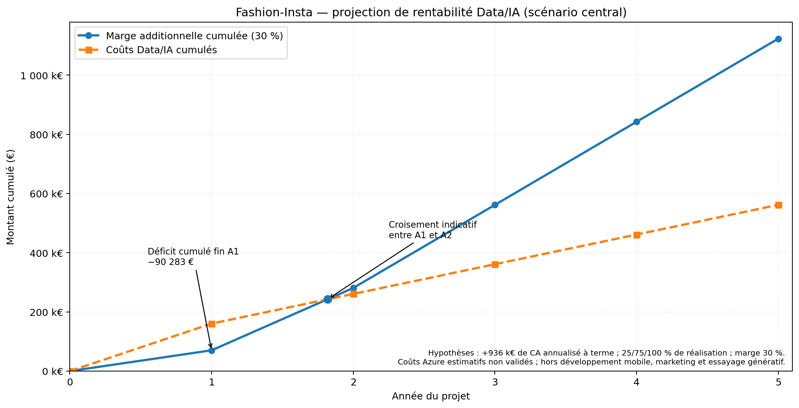

# P11 — Réalisez le cadrage d'un projet IA | Fashion-Insta

> **Projet pédagogique OpenClassrooms — Data / IA**  
> **Mission :** cadrer un système de recommandation vestimentaire par l'image, préparer une décision COMEX et anticiper l'industrialisation.  
> **Statut :** cadrage et livrables préparés ; **PoC non développé et non exécuté**. Les résultats, budgets et performances ci-dessous sont des hypothèses à valider.

## Sommaire

1. [Contexte et enjeu métier](#1-contexte-et-enjeu-métier)
2. [Périmètre du PoC](#2-périmètre-du-poc)
3. [Approches IA et protocole d'évaluation](#3-approches-ia-et-protocole-dévaluation)
4. [Architecture cible Microsoft Azure](#4-architecture-cible-microsoft-azure)
5. [Planning, équipe et coûts](#5-planning-équipe-et-coûts)
6. [ROI prévisionnel](#6-roi-prévisionnel)
7. [Gouvernance et RGPD](#7-gouvernance-et-rgpd)
8. [Organisation du dépôt et livrables](#8-organisation-du-dépôt-et-livrables)
9. [Utilisation du projet](#9-utilisation-du-projet)
10. [Points restant à valider](#10-points-restant-à-valider)

## 1. Contexte et enjeu métier

**Fashion-Insta** commercialise des vêtements dans **11 magasins** et via un site e-commerce. L'entreprise envisage une application mobile capable de recommander des références de son catalogue à partir des photographies de vêtements appréciés par les clients.

Alicia, **VP Product**, souhaite obtenir du COMEX l'autorisation de lancer une preuve de concept (**PoC**) courte, mesurable et maîtrisée sur le plan financier et réglementaire.

### Données métier communiquées (2024)

| Indicateur | Valeur |
| --- | ---: |
| Chiffre d'affaires global | **10,4 M€** |
| CA e-commerce | **5,2 M€** |
| CA magasins | **5,2 M€** |
| Visiteurs uniques web par an | **950 000** |
| Références produits vendues | **875** (9 catégories) |
| Utilisateurs de l'application estimés à terme | **400 000 au moins une fois par an** |
| Objectifs Marketing à 24 mois | **+14 %** de CA web et **+4 %** en magasin |

Les objectifs Marketing sont des **projections commerciales**, pas des gains obtenus. Les visiteurs web et les futurs utilisateurs de l'application ne doivent pas être confondus.

**Question de cadrage :** une approche IA peut-elle proposer des vêtements **visuellement et stylistiquement pertinents** à partir d'une photographie, avec une valeur ajoutée mesurable face à une recherche classique par attributs ?

## 2. Périmètre du PoC

Le PoC teste **une fonctionnalité centrale**, sans construire l'application mobile complète.

| Paramètre | Proposition de cadrage |
| --- | --- |
| Catégorie pilote | **Pantalons et jeans** |
| Catalogue pilote | **120 références**, représentant environ **27 %** du CA déclaré |
| Données d'entrée | **40 photos de test** envisagées, indépendantes des photos catalogue |
| Sortie | **Top 5** de références distinctes pour chaque photo |
| Durée | **15 jours ouvrés**, soit 3 semaines **après** accord du COMEX |
| Charge | **30 jours-homme** Data/IA |
| Décision finale | **Go / No-Go** sur la suite du projet |

Les comptes clients, la garde-robe numérique, le paiement, le déploiement mobile, l'essayage virtuel et les recommandations avancées par tendances restent **hors du PoC**. Ces besoins sont toutefois pris en compte dans la vision du produit cible.

### Provenance des photographies

Le catalogue interne fournit des photos produits, des descriptions, des prix et des tags. Ces données sont réparties entre plusieurs systèmes et nécessitent une consolidation.

Le jeu externe **[DeepFashion2](https://github.com/switchablenorms/DeepFashion2)** a été identifié comme **candidat** pour des requêtes de test proches de photographies réelles (*consumer-to-shop*). **Il n'est ni annoncé comme téléchargé, ni autorisé pour l'usage prévu** : les licences, les droits sur les images et la représentativité doivent être vérifiés avec les métiers et le DPO.

## 3. Approches IA et protocole d'évaluation

Trois configurations sont **proposées** pour le futur test :

| Configuration | Principe | Rôle |
| --- | --- | --- |
| **Baseline sans IA** | Classement à partir des tags/attributs (catégorie, style, couleur) | Mesurer l'apport réel de l'IA |
| **A — CLIP / OpenCLIP** (prioritaire) | Embeddings d'images et **similarité cosinus** | Recherche visuelle simple à expérimenter |
| **B — Vision-langage** (alternative limitée) | Extraction de caractéristiques (coupe, couleur, style), puis comparaison aux attributs du catalogue | Tester un gain possible d'explicabilité/pertinence |

« **Alternative multimodale limitée** » signifie une **exploration secondaire, bornée dans le temps**, d'un modèle vision-langage ; il ne s'agit pas de développer deux moteurs industriels complets.

CLIP/OpenCLIP est un **modèle préentraîné** : la préparation des embeddings n'est pas un réentraînement. Le moteur de recommandation est une **recherche vectorielle**, **pas un RAG complet**. Un modèle génératif d'images de type Stable Diffusion est envisagé **séparément** pour un éventuel essayage virtuel.

### Critères de succès proposés (non encore mesurés)

| Indicateur | Seuil cible | Interprétation |
| --- | ---: | --- |
| **Precision@5** | **≥ 60 %** | Au moins 120 recommandations jugées pertinentes sur 200 (40 × 5) |
| **Success@5** | **≥ 80 %** | Au moins 32 photos sur 40 obtiennent **une** suggestion pertinente dans le Top 5 |
| **Gain P@5 vs tags** | **≥ +10 points** | La précision de l'IA dépasse celle de la baseline sans IA d'au moins 10 points |

Les mêmes photos et le même catalogue doivent servir à toutes les configurations. Deux évaluateurs métier jugent idéalement les suggestions selon une grille partagée (type, coupe, matière apparente, couleur et style). L'échantillon limité fournit un **signal de faisabilité**, pas une mesure définitive de performance en production.

## 4. Architecture cible Microsoft Azure

Le design distingue deux traitements complémentaires :

- **BATCH :** préparation et actualisation des embeddings des images du **catalogue**, avant les requêtes clients.
- **ONLINE :** traitement de **chaque nouvelle photo client** et interrogation de l'index des produits déjà préparé.



> **Services proposés, non déployés :** Azure Blob Storage (images), Azure Data Factory (ingestion), Azure SQL (métadonnées), Azure Machine Learning (calculs batch et inférence online). **Azure AI Search est optionnel** pour la recherche vectorielle et les filtres ; sur le PoC de 120 références, une comparaison vectorielle simple peut suffire.

La différence essentielle : **le batch prépare la représentation des produits ; l'online exploite cette représentation pour répondre au client.** Les deux flux doivent utiliser des embeddings compatibles, issus du même modèle et du même prétraitement approprié.

### Évolutions possibles

La solution cible pourra gérer les préférences de style/marque, les avis, la garde-robe et, après étude distincte, l'essayage virtuel via un modèle génératif. **Cette génération d'images n'est pas incluse dans le budget ni le ROI central** du moteur de recommandation.

## 5. Planning, équipe et coûts

### Phases de réalisation proposées

| Phase | Durée | Jours-homme | Objectif |
| --- | ---: | ---: | --- |
| **PoC** | 3 semaines | 30 | Vérifier pertinence, faisabilité, droits sur les données ; Go/No-Go |
| **MVP Data/IA** | 10 semaines | 180 | Industrialiser ingestion, batch, recherche online, feedback, MLOps |
| **Run initial** | 4 semaines | 36 | Pilote progressif, supervision, stabilisation |
| **Total jusqu'au Run initial** | **17 semaines** | **246** | |

L'équipe Data interne comprend **3 Data Scientists**, **2 Data Engineers**, **1 Tech Lead Data** et **1 MLOps Engineer**. Les métiers, Alicia, le DPO et les responsables sécurité sont également consultés. Le suivi prévoit des **Coprojs hebdomadaires** et des **Copils aux jalons proposés**.

### Enveloppes financières de cadrage (Data/IA seulement)

| Poste | Montant indicatif |
| --- | ---: |
| Ressources humaines de lancement | **89 360 €** |
| Services Azure de lancement | **3 600 €** |
| **Lancement PoC + MVP + Run initial** | **92 960 €** |
| Run stabilisé — ressources humaines | **6 560 €/mois** |
| Run stabilisé — Azure | **1 800 €/mois** |
| **Run stabilisé annuel** | **100 320 €/an** |

Ces montants reposent sur les **coûts salariaux journaliers internes** communiqués par Fashion-Insta et sur des **enveloppes Azure simulées**, et non sur un devis fournisseur. Ils n'incluent notamment **ni le développement mobile ni les dépenses d'acquisition/marketing**. Le chiffrage d'une extension générative doit rester séparé et nécessite un recalcul du ROI si elle est retenue.

## 6. ROI prévisionnel

À horizon de 24 mois, les objectifs Marketing correspondent, au rythme annuel cible, à :

- **728 000 €/an** de CA additionnel web (`5,2 M€ × 14 %`) ;
- **208 000 €/an** de CA additionnel magasins (`5,2 M€ × 4 %`) ;
- **936 000 €/an** de **CA additionnel annualisé** au total — **pas de bénéfice net**.

Le scénario central fait l'hypothèse **non validée** d'une **marge contributive de 30 %** et d'une réalisation moyenne du gain cible de **25 % en A1**, **75 % en A2**, puis **100 % à partir d'A3**. Le graphique compare la **marge additionnelle cumulée** et les **coûts Data/IA cumulés** sur cinq ans.



**Résultat de la simulation :** un croisement des courbes est projeté **pendant l'année 2**, **uniquement** si les hypothèses de croissance, de marge, de calendrier et de coûts se réalisent. Ce **n'est pas le ROI de l'application complète** : les coûts hors Data/IA et l'option d'essayage génératif sont exclus.

## 7. Gouvernance et RGPD

Les traitements ciblent non seulement les photos, mais aussi les **comptes, préférences, historiques, logs et embeddings associés à une personne**.

**Mesures proposées, à faire valider par le DPO :**

- information des utilisateurs, base légale définie **pour chaque finalité**, minimisation des données et contrôle des droits ;
- retrait des métadonnées EXIF, recadrage/masquage si pertinent, chiffrement et limitation des accès ;
- suppression des photos temporaires et gestion coordonnée des demandes d'effacement ;
- **absence de réutilisation des photos clientes pour entraîner des modèles tiers**, à garantir par l'architecture, les paramètres et les contrats ;
- **pseudonymisation** des données individuelles d'exploitation et **agrégation/anonymisation vérifiée** pour les statistiques, sans confondre les deux ;
- analyse de la nécessité d'une **AIPD**, registre des traitements et contrôles de conservation.

Une architecture basée sur un **modèle préentraîné auto-hébergé dans Azure ML**, avec isolation réseau adaptée, est proposée comme alternative à un appel direct à une API publique. **La conformité RGPD et les garanties fournisseur ne sont pas présentées comme déjà obtenues.**

## 8. Organisation du dépôt et livrables

```text
P11_Cadrage_Projet_IA_FashionInsta/
├── README.md
├── docs/
│   ├── 01_analyse_besoins_metier.md
│   ├── 02_perimetre_poc.md
│   ├── 03_approches_techniques_poc.md
│   ├── 04_criteres_succes_ressources_planification.md
│   ├── 05_chiffrage_ressources_humaines_partie2.md
│   ├── 06_dimensionnement_couts_azure_partie2.md
│   ├── 07_analyse_roi_rentabilite_partie2.md
│   ├── 07_graphique_roi_cumule_partie2.png
│   └── 08_risques_rgpd_partie3.md
├── livrables/
│   ├── P11_FashionInsta_Partie3_Etape1_RGPD.pptx
│   └── archives/                  # Versions précédentes
├── sources/
│   ├── P11_Profils_Data.pdf
│   └── templates/
│       └── P11_DS_Template_Timeline.pptx
├── assets/
├── .gitignore
└── pyproject.toml
```

**Présentation de référence :** `livrables/P11_FashionInsta_Partie3_Etape1_RGPD.pptx` (version consolidée de la mission, avec les ajouts du guide mentor). Les anciens PowerPoint sont conservés dans `livrables/archives/`. Un guide de soutenance orale peut être conservé séparément dans `docs/` ; il ne remplace pas la présentation.

### Documents par partie

| Partie | Documents / livrables |
| --- | --- |
| **1 — Cadrage du PoC** | `docs/01` à `docs/04` ; cadrage métier, périmètre, techniques, métriques |
| **2 — Architecture et économie** | `docs/05` à `docs/07` ; responsabilités, timeline, coûts, ROI |
| **3 — Risques et protection des données** | `docs/08` ; RGPD, confidentialité, contrôle du non-entraînement |
| **Soutenance** | PowerPoint consolidé et, le cas échéant, guide oral distinct |

## 9. Utilisation du projet

Ce dépôt est **documentaire** : il ne contient pas de moteur de recommandation exécutable à lancer. PyCharm sert à organiser les documents, prévisualiser le Markdown et versionner les livrables.

```bash
# Récupérer le dépôt
 git clone https://github.com/VincentDesmouceaux/P11_Cadrage_Projet_IA_FashionInsta.git
 cd P11_Cadrage_Projet_IA_FashionInsta

# Vérifier les fichiers avant d'enregistrer des modifications
 git status
```

Dans PyCharm, ouvrir `README.md` et utiliser la **prévisualisation Markdown**. Pour la soutenance, ouvrir le `.pptx` dans PowerPoint ou Keynote ; **aucune exécution de PoC n'est nécessaire** pour présenter le cadrage demandé.

## 10. Points restant à valider

1. **Données :** disponibilité et droits des images catalogue et du dataset candidat, représentativité des 40 photos.
2. **Évaluation :** critères métier de similarité, seuils, annotateurs et protocole de non-fuite.
3. **Infrastructure :** droits d'accès Azure, SKU/régions, latence, montée en charge, stockage et devis vérifiables.
4. **Finances :** disponibilité des profils, marge contributive de 30 %, trajectoire de vente et limites du ROI Data/IA.
5. **RGPD :** durées de conservation, contrats fournisseur, effacement, analyse AIPD et garanties de non-entraînement.
6. **Extension générative :** cas d'usage, faisabilité, GPU, coûts et décision de financement séparée.

---

**Note méthodologique :** ce dépôt formalise **ce qui serait réalisé** si le PoC était autorisé. Aucune Precision@5, aucun gain commercial ni aucune conformité fournisseur n'est revendiqué comme résultat observé. Les choix, chiffrages et seuils sont des **propositions de cadrage à défendre et à valider** avec les parties prenantes.
